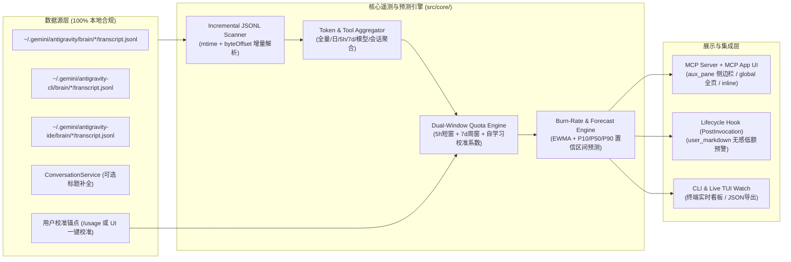

# Antigravity Usage Monitor 详细架构与算法设计文档

## 1. 设计目标与核心痛点

在使用 Google Antigravity（Desktop App / IDE / CLI）进行高强度 Agent 开发时，开发者面临以下痛点：
1. **缺乏持续可见的额度消耗趋势**：原生 `/usage` 或 Settings → Models 仅展示静态快照，无法直观看到当前燃烧速度与“照此速度下去，到下次刷新时还能剩多少百分比”。
2. **双层刷新窗口难以把控**：Antigravity 同时存在 **5 小时滚动刷新窗口（5h Rolling Window）** 与 **7 天周度基线配额（7d Weekly Cap）**，高强度使用高阶推理模型可能提前击穿短窗或周窗。
3. **Token 构成不透明**：Agent 多轮工具调用中，Fresh Input、Prompt Cache Read、Output/Thinking Token 占比差异巨大；缺乏跨会话总 Token 统计与缓存命中率分析。
4. **缺少主动预警机制**：在额度即将触底前，开发者往往在任务中途突然撞墙，导致工作流中断。

**Antigravity Usage Monitor** 通过 **100% 遵循 Antigravity 官方文档与合规接口** 的方式，提供集 **原生 MCP App 可视化面板（侧边栏 + 全局页 + 对话内嵌）+ 生命周期 Hook 预警 + 独立 CLI/TUI 实时监控** 于一体的本地零遥测监控方案。

---

## 2. 系统总体架构



### 2.1 合规性与零遥测原则
- **仅读取官方公开路径**：扫描 Antigravity 官方记录的 `transcript.jsonl` 日志（支持 Antigravity 2.0、CLI、IDE 三个目录）以及可选调用官方 `ConversationService` 补全会话标题。
- **不探测未公开内部端口/私有协议**：通过“本地精确 Token 遥测 + 用户一键校准锚点（支持自动学习 Token-to-Quota 换算系数）”解决额度百分比对齐问题，既 100% 稳定合规，又不随版本更新失效。
- **纯本地运行**：无任何外部网络请求、无遥测上报，所有状态持久化在 `${PLUGIN_DATA}` 或 `~/.gemini/antigravity-usage-monitor/`。

---

## 3. 数据模型与指标体系

### 3.1 Token 精细拆解
每条 `PLANNER_RESPONSE` 记录提取：
- `input_tokens`：新增未命中缓存的输入 Token（Fresh Input）
- `cache_read_tokens`：Prompt Cache 命中的输入 Token（Cache Read）
- `output_tokens`：模型生成与思考输出 Token（Output + Thinking）
- `total_tokens` = `input_tokens + cache_read_tokens + output_tokens`
- **缓存命中率（Cache Hit Rate）**：
  $$\text{CacheHitRate} = \frac{\text{cache\_read\_tokens}}{\text{input\_tokens} + \text{cache\_read\_tokens}}$$
- **等效计费加权 Token（Effective Weighted Tokens）**：
  不同 Token 类型对计算配额的消耗权重不同（Prompt Cache 成本极低，Output 推理权重最高）：
  $$W = w_{\text{tier}}(\text{model}) \times \left(1.0 \cdot T_{\text{in}} + \gamma_{\text{cache}} \cdot T_{\text{cache}} + \beta_{\text{out}} \cdot T_{\text{out}}\right)$$
  默认权重（可配置）：$\gamma_{\text{cache}} = 0.10$，$\beta_{\text{out}} = 4.0$；模型倍率 `gemini-4-neon-high` / `pro` = 1.0，`flash` = 0.25，`claude`/`gpt` = 1.25。

### 3.2 模型配额池（Model Pools）
将具体模型 ID 归一化映射到配额池：
| 配额池 ID | 典型模型匹配 | 默认权重倍率 | 说明 |
| :--- | :--- | :--- | :--- |
| `gemini-pro` | `gemini-4-neon*`, `gemini-*-pro*`, `auto` | `1.0` | 高阶主力模型池 |
| `gemini-flash` | `gemini-*-flash*` | `0.25` | 轻量高速模型池 |
| `partner` | `claude-*`, `gpt-*`, `o1*`, `o3*` | `1.25` | 第三方合作模型池 |

---

## 4. 双窗口额度与“下次刷新时余下百分比”预测算法

### 4.1 双层刷新窗口建模
对每个模型池及全局总池同时追踪两个窗口：
1. **短窗口（5h Rolling / Fixed Window）**：默认 `300 分钟`（5 小时）。
   - 若存在有效校准锚点（`nextResetAt > now`），以 `nextResetAt` 为准确刷新时刻，窗口起点为 `nextResetAt - windowMs`。
   - 若无校准锚点，则以窗口内最早一次请求时间 `firstEventInWindow + windowMs` 作为滚动刷新预测时刻。
2. **周窗口（7d Weekly Cap）**：默认 `168 小时`（7 天）。同样支持锚点校准与滚动推算。

### 4.2 锚点校准与自学习系数（Auto-Learning Calibration）
用户只需将 Antigravity 原生 `/usage` 或 `Settings → Models` 显示的 **剩余百分比 $R_t$** 和 **距离刷新时间 $\Delta t_{\text{reset}}$** 输入一次：
- **单点锚定**：记录锚点 $(t_0, R_0, t_{\text{reset}}, W_{\text{cum}}(t_0))$。
  任意后续时刻 $t \in [t_0, t_{\text{reset}})$ 的当前估算剩余百分比：
  $$\hat{R}(t) = \text{clamp}\left(R_0 - \frac{W_{\text{cum}}(t) - W_{\text{cum}}(t_0)}{K_{\text{pool}}}, \; 0, \; 100\right)$$
  其中 $K_{\text{pool}}$ 为该配额池“每消耗 1% 额度对应的加权 Token 数”。
- **两点自学习校准**：当用户在同一个刷新周期内输入第二次校准点 $(t_1, R_1)$ 且 $\Delta R = R_0 - R_1 \ge 2\%$、$\Delta W = W_{\text{cum}}(t_1) - W_{\text{cum}}(t_0) > 0$ 时，观测系数为 $K_{\text{obs}} = \Delta W / \Delta R$。采用阻尼指数平滑更新（防单次抖动）：
  $$K_{\text{new}} = 0.6 \cdot K_{\text{obs}} + 0.4 \cdot K_{\text{old}}$$
  从而越用越准，无需硬编码官方黑盒倍率。

### 4.3 燃烧率估计与“下次刷新时余下百分比”预告
将当前窗口划分为等宽时间桶（默认 5 分钟一桶，保留活跃桶序列 $b_1, b_2, \dots, b_n$，单位：`% / hour`）：
1. **近期瞬时燃烧率 $r_{\text{recent}}$**：过去 30 分钟内的平均消耗速率。
2. **EWMA 平滑燃烧率 $r_{\text{ewma}}$**（$\alpha = 0.35$）：对近期的突发调用更敏感，同时过滤单轮长工具链尖峰。
3. **窗口均速 $r_{\text{avg}}$**：本窗口已消耗百分比 ÷ 窗口内已过活跃时长。
4. **融合预测燃烧率**：
   $$r_{\text{expected}} = 0.50 \cdot r_{\text{ewma}} + 0.30 \cdot r_{\text{recent}} + 0.20 \cdot r_{\text{avg}}$$
   （若最近超过 20 分钟无调用，引入活跃衰减因子，避免静默闲置时段误报持续满速燃烧，同时在 UI 中展示“活跃持续速度”与“当前衰减速度”两种视角）。
5. **下次刷新时预告余下百分比**：
   设距下次刷新剩余小时数为 $H_{\text{rem}} = \max(0, (t_{\text{reset}} - t_{\text{now}}) / 3600000)$：
   $$\hat{R}_{\text{at\_reset}} = \text{clamp}\left(\hat{R}(t_{\text{now}}) - r_{\text{expected}} \cdot H_{\text{rem}}, \; 0, \; 100\right)$$
6. **P10 / P50 / P90 置信区间（乐观 / 预期 / 保守）**：
   根据活跃时间桶消耗速率的标准差 $\sigma_r$ 计算：
   - **乐观预测（Optimistic）**：使用 $\max(0, r_{\text{expected}} - 0.8 \sigma_r)$
   - **预期预测（Expected）**：使用 $r_{\text{expected}}$
   - **保守预测（Conservative）**：使用 $r_{\text{expected}} + 1.0 \sigma_r$
7. **耗尽倒计时（Runway / ETA）与安全节奏（Safe Pace）**：
   - 若 $\hat{R}_{\text{at\_reset}} = 0$ 且 $r_{\text{expected}} > 0$：
     - 预计耗尽耗时：$T_{\text{runway}} = \hat{R}(t_{\text{now}}) / r_{\text{expected}}$（小时）
     - 预计断档等待时长：$T_{\text{lockout}} = H_{\text{rem}} - T_{\text{runway}}$
   - **安全节奏预算（保留 5% 缓冲）**：
     $$r_{\text{safe}} = \frac{\max(0, \hat{R}(t_{\text{now}}) - 5)}{H_{\text{rem}}} \quad (\% / \text{hr})$$

---

## 5. 插件与多端集成设计

### 5.1 Antigravity MCP App (`src/mcp/server.ts` + `src/ui/`)
- 遵循 SEP-1865 (`@modelcontextprotocol/ext-apps`)，打包为单文件 HTML 资源 `ui://antigravity-usage-monitor/dashboard.html`（`text/html;profile=mcp-app`）。
- 注册双入口：`aux_pane`（侧边栏 `+` 菜单）与 `global`（左侧全局导航页），同时支持对话内 `inline` 卡片展示。
- 自动响应 Antigravity 宿主主题变量（`applyDocumentTheme` + `applyHostStyleVariables` + `onhostcontextchanged`），无硬编码违和色。
- 提供模型工具与 App 专属工具（`visibility: ["app"]`），前端操作校准/改配置直接经 `app.callServerTool()` 持久化，无需依赖 iframe 本地存储。

### 5.2 Lifecycle Hook (`src/hooks/post-invocation.ts` + `hooks.json`)
- 挂载在 `PostInvocation` 钩子，使用增量字节偏移扫描（平均耗时 < 25ms），不拖慢 Agent 循环。
- 当预测刷新时余下百分比低于警告阈值（默认 `15%`）或预计提前耗尽时，通过 `systemMessage.metadata.user_markdown` 向用户展示精简横幅，同时将 `systemMessage.systemMessage` 置空，**不消耗任何额外模型输入 Token**，并带有 15 分钟防打扰冷却期。

### 5.3 独立 CLI / Live TUI (`src/cli/index.ts`)
- 支持 `status`、`forecast`、`watch`（每 5 秒刷新终端仪表盘）、`conversations`、`calibrate`、`config`、`export`。
- 适合在 Antigravity IDE 终端、tmux 或任意外部终端中常驻监控。

---

## 6. 目录结构

```text
Antigravity-Usage-Monitor/
├── DESIGN.md                        # 本详细架构与算法设计文档
├── README.md                        # 快速上手与使用指南
├── package.json                     # 依赖与构建脚本
├── tsconfig.json                    # TypeScript 编译配置
├── vite.config.ts                   # MCP App 单文件 HTML 打包配置
├── vitest.config.ts                 # 测试配置
├── src/
│   ├── core/
│   │   ├── types.ts                 # 完整类型定义
│   │   ├── config.ts                # 套餐预设、模型池映射、持久化状态读写
│   │   ├── scanner.ts               # 多端 transcript.jsonl 增量扫描器
│   │   ├── engine.ts                # 双窗口额度、自学习校准与 EWMA 预测引擎
│   │   └── index.ts                 # 核心模块统一导出
│   ├── mcp/
│   │   └── server.ts                # MCP Server (Tools + ui:// Resource)
│   ├── ui/
│   │   ├── index.html               # MCP App HTML 入口
│   │   ├── styles.css               # 宿主主题自适应样式
│   │   └── main.ts                  # MCP App 交互仪表盘与 SVG 预测曲线
│   ├── hooks/
│   │   └── post-invocation.ts       # PostInvocation 低额预警 Hook
│   └── cli/
│       └── index.ts                 # 独立 CLI 与 Live TUI Watch
├── plugin/                          # 标准 Antigravity 插件清单模板
│   ├── plugin.json
│   ├── mcp_config.json
│   ├── hooks.json
│   ├── assets/logo.svg
│   └── skills/usage-monitor/SKILL.md
├── scripts/
│   └── install-plugin.mjs           # 一键安装到 ~/.gemini/config/plugins/
└── tests/
    ├── scanner.test.ts              # 增量扫描与解析测试
    ├── engine.test.ts               # 双窗口、自学习校准与预测算法测试
    ├── hook.test.ts                 # 钩子预警与冷却防抖测试
    └── mcp-server.test.ts           # MCP 工具与 ui:// 资源协议测试
```
